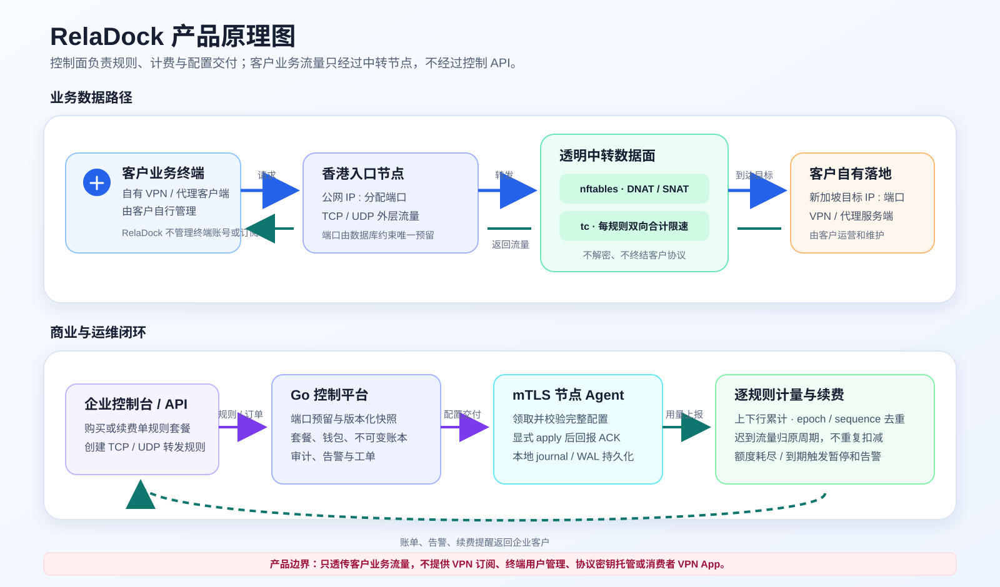
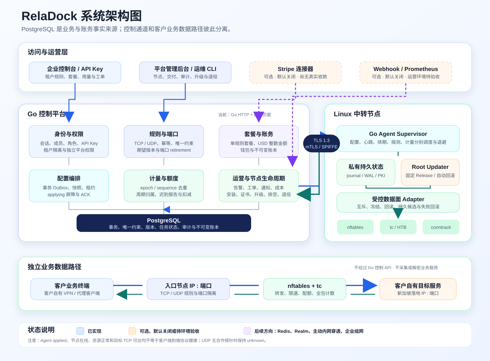

# RelaDock

v0.9.8 在既有 Agent 可靠性、受控升级与安全退役基础上增加控制端动态节点监控：企业工作台仅聚合本企业未删除规则的节点流量，平台后台可查看跨企业节点汇总；两端均展示上下行速率、累计流量、Agent 本次进程运行时间以及 CPU、内存、根磁盘和 conntrack。页面可见时每 5 秒刷新、后台标签页每 30 秒刷新，请求不重叠，失败保留最后成功值。控制台统一为蓝色主题。节点“在线”、资源正常、配置 applied、目标 TCP 可达与端到端转发健康仍是独立事实。此版本不改变生产 Agent 功能或版本，实际转发仍单独确认，详见 [部署说明](docs/DEPLOYMENT.md)。

网络中转与后续企业组网平台。只透传客户业务和 VPN 协议流量，不提供 VPN 订阅或终端用户管理。

当前后端为 **Go + PostgreSQL**，包含企业账户、邀请与角色、API Key、TCP/UDP 规则、平台管理、mTLS 配置交付、逐规则计量、钱包账本、规则套餐、告警工单和默认关闭的回环 Prometheus 指标端口。Linux 显式应用模式已组合 nftables 转发、tc 单规则双向合计限速、持久 WAL、内核额度/到期保护与 applied ACK。Node.js 只用于本地脚本。加密恢复包创建和隔离校验工具已实现；真实生产 VPS、支付、离机复制及替换主机演练仍需验收，不能直接宣称生产就绪。

源码仓库：[LightToUs/reladock](https://github.com/LightToUs/reladock)。运行密码、证书、备份和运行状态不进入仓库。

全平台管理后台已接入真实权限与数据库，入口为 [平台管理](http://127.0.0.1:3001/admin)。企业 owner 默认没有平台权限。

## 产品原理与系统架构

RelaDock 将控制面与业务数据面分离：控制平台负责企业、规则、端口、套餐、账务、配置交付、计量和告警；客户业务流量经 Linux 中转节点透明转发，不经过控制 API，也不由平台解密或终结客户协议。

### 产品原理图



### 系统架构图



图中实线组件为当前已实现主体；虚线组件表示可选、默认关闭、尚待环境验收或后续方向。Agent `applied`、节点在线、资源正常和目标 TCP 可达均不等于客户端到端协议健康。

## 本地运行

需要 Go 1.24+、Node.js 20+、Docker 与 Docker Compose。

```bash
npm run setup
npm run db:start
npm start
```

打开 [本地控制台](http://127.0.0.1:3001/)，选择“开通企业账户”，自行填写企业名称、邮箱与密码（12–128 字节）。没有默认账号或默认管理密码。

- `npm run setup` 生成仅本机使用的随机数据库密码，保存于权限为 0600 且被忽略的 `.env`；重复执行保留已有配置。
- 数据库只映射 `127.0.0.1:55434`；服务只监听 `127.0.0.1:3001`。`.env` 中的 `PORT` 可修改；脚本也尊重已有环境变量。
- 首次启动自动执行版本迁移。数据库不可用时启动失败，不回退到 JSON 或内存。
- `npm start` 构建并运行 Go 程序；修改代码后重启。Ctrl+C 停止服务。
- `npm run db:stop` 停止数据库且保留数据卷；再次 `npm run db:start` 恢复。
- 旧 `data/state.json` 如存在会保留，不自动导入，也不参与新控制台读写。

## 已实现的操作

1. 开通企业并登录，使用 HttpOnly、SameSite=Strict 会话 Cookie，24 小时后过期；退出后旧会话立即失效。
2. 在企业工作台对话框创建 TCP、UDP 或双协议规则，填写客户实际目标。端口范围 20000–60000，由数据库唯一约束保证；相同数字端口的 TCP/UDP 是不同资源。
3. 查看本企业规则与期望/生效版本，并在对话框中编辑名称、目标主机、目标端口和逐规则带宽。编辑使用期望版本防止旧页面覆盖，不原地改变入口节点、传输类型或已分配端口；活动套餐存在时不能把带宽提高到套餐上限以上。暂停与恢复均等待应用确认；未曾下发的删除可以释放端口，已下发端口保持隔离，只有 apply-only Agent 完成精确 conntrack 清理、持久回报并取得 ACK 后才受控复用。
4. 查看本企业最近 50 条账户和规则审计。其他企业不能读取或操作这些规则。
5. 选择入口节点，查看维护状态、期望/校验配置版本、交付状态及最近联系。配置校验和联系记录均不代表实际转发健康。

企业工作台按“运行概览 → 转发规则 → 流量与入口节点资源 → 节点状态 → 节点交付”组织日常操作，并分别呈现配置已应用、待交付和节点联系记录；这些控制面事实不会被合并成虚构的健康状态。规则列表自动显示逐规则累计上下行和最近两个同 epoch 报告的接收时间差值速率；选中规则的遥测区另行显示相对规则带宽上限的利用率，并可选择 1 小时、24 小时或 7 天接收时间趋势。节点状态只聚合当前企业未删除规则关联的节点数据，不泄露其他企业流量。超过 30 秒的最近报告显示速率过期，样本不足或空档保持未知，不推断为零流量。

创建 API 要求 `Idempotency-Key`，相同请求重放不重复占用端口，改变请求内容会返回 409。页面会保留网络结果不确定时的请求键供重试。

## 新增业务与部署基础

- 企业所有者/管理员可生成邮箱绑定的一次性邀请，受邀人在登录页设置密码并加入。令牌只显示一次，不自动发邮件。角色变更撤销旧会话及 Key；不能创建其他 owner 或授予平台权限。
- 成员可创建限时只读/读写 API Key；Key 仅保存摘要，只能操作本企业，不能访问平台管理或管理其他凭据。API 请求使用 `Authorization: Bearer ...`，写请求仍需 `X-Requested-With: RelaDock`，规则创建要求幂等键。
- 流量额度与带宽按每条转发独立配置，企业不共享字节池。企业页面已移除全局试点流量、带宽和币种卡片；节点物理声明上限继续保留。
- 平台管理员可创建不可变套餐价格版本，企业可从钱包为自己的规则购买/到期续购。无预置套餐或虚构余额。扣费与账本、配置快照和审计同事务。未购买、已到期或流量耗尽的规则在下发快照中保持暂停；端口草稿不会因此获得免费转发权限。
- 开发联调可由部署者显式设置 `RELADOCK_DEVELOPMENT_ALLOW_UNENTITLED_RULES=true`。它只绕过套餐、配额和到期门槛，不伪造订阅或账本，不解除人工暂停/删除，并继续逐规则采集流量；默认关闭，商业生产必须保持关闭。切换后需重启控制服务并为节点生成新配置。
- `POST /agent/usage` 经独立 mTLS 节点身份鉴权接收逐规则累计上下行，校验重放、冲突和计数重置。付费报告绑定 `subscriptionId` 与物理计数 epoch；迟到流量归原周期。应用模式采集完整 forward named counters，切换前冻结平台链并落盘；没有实际报告仍显示未知。
- 企业工作台的流量趋势按不可变报告的**平台接收时间**聚合，只用于运营展示，不改变账单周期归属；近期带宽也是接收时间差值估算，不是瞬时采样或 SLA。节点资源卡只读取关联入口节点的最新样本，控制端不保存长期 CPU/内存/磁盘/conntrack 时序，长期留存仍需外部监控系统。
- 节点联系超时、配置失败、证书临期/过期、持续一小时的轮换失败，以及持续资源压力、时钟偏差和本地转发配置漂移告警可去重、解除与复发；告警状态变更同事务写通知 Outbox。CPU/内存 90%、根磁盘 85%、conntrack 80% 需持续 5 分钟，时钟偏差超过 120 秒或配置漂移需持续 2 分钟；单次尖峰不报警，90 秒未收到新样本则显示遥测过期并由联系状态单独判断。可选签名 HTTPS webhook 默认关闭，有持久重试与后台投递/重试页面，接收方按事件编号去重。通知不含证书、CSR、摘要、私钥、原始命令输出或 Agent 原始错误。工单隔离企业，联系或资源状态都不是数据面健康。
- 平台可录入不可变节点成本与凭据，查看实际套餐扣费减已录成本的现金口径差额；未录成本显示未知，不把充值当收入，也不声称会计应计毛利。见 [成本口径](docs/COSTS.md)。
- `APP_ENV=production` 要求明确 HTTPS origin 和 TLS 文件。支持独立 Agent 监听，生产 API 限流共享 PostgreSQL 状态。`npm run build:release` 生成 Linux 二进制、校验和及 systemd/安装模板；参阅 [部署说明](docs/DEPLOYMENT.md)。
- 可选 Stripe 连接器默认禁用，测试验签、金额/币种校验、重复到账与退款复核；未激活商户或执行真实支付。接入方式与限制见 [支付说明](docs/PAYMENTS.md)。

本地运维可使用 `wallet-adjust` 做明确授权的账务修正（整数美分、原因、操作人和幂等键），必须提供 `--acknowledge-wallet-adjustment`。这不是支付到账，不对网页开放，不得用来伪造充值。

### 测试命令

先启动本地数据库，再执行：

```bash
npm test
npm run vet
```

`npm test` 运行真实 PostgreSQL 集成测试及 Go 竞态检测。默认使用 `.env` 中的数据库连接，每个测试创建随机 schema，只清理自己创建的 schema。可通过 `TEST_DATABASE_URL` 指向独立测试数据库，数据库用户需要 CREATE SCHEMA 权限。不要使用生产数据库。缺少连接配置时测试脚本报错；直接运行 `go test` 且没有 `TEST_DATABASE_URL` 时数据库测试会跳过，不能把这种结果当作完整验证。

覆盖会话过期与撤销、重复注册事务回滚、数据库重连与迁移重跑、并发分配、TCP/UDP 分离、双协议原子占用、跨企业越权、幂等重放/冲突、审计失败回滚、暂停/删除、严格输入、同源保护与登录限流。

另外覆盖 v1 数据无损升级与队列回填、完整快照并发、Outbox 失败回滚、租约超时回收、重复/过期回报、失败退避、证书轮换与人工重试，以及实际 TLS 握手中的证书拒绝和校验 Agent 往返。

## 节点运维与配置交付

### 全平台管理后台

先通过企业控制台创建账号，再由本机运维显式授予平台权限：

```bash
npm run admin -- platform-admin --email 'your-account@example.com' --enabled=true
# 撤销权限：
npm run admin -- platform-admin --email 'your-account@example.com' --enabled=false
```

授权或撤销会清除该成员全部旧会话，必须重新登录。没有首次注册自动成为管理员、按邮箱猜测管理员、前端设置管理员或公开授权接口。平台授权独立于企业 owner/admin/viewer。平台管理员从登录页登录后会进入 `/admin`，也可随时切换到企业工作台；企业查询仍只显示本人所属企业。

后台已实现：

- 平台总览：企业、停用企业、节点、维护节点、规则、暂停规则、最新配置失败数，全部来自数据库。
- 入口节点：列表中追加动态上下行速率、累计流量、Agent 运行时间和 CPU/RAM/存储/conntrack；自动刷新只修补监控单元格，不重建管理控件或关闭弹窗。每个可用管理按钮都在当前页面通过弹出对话框显示表单、内容或操作确认。仅从未部署、没有证书、Agent、规则、端口、交付尝试、升级、退役、成本或观测历史的空节点可撤销登记；其他节点只能进入不可逆安全排空并保留证据。
- 企业客户：分页查看企业、所有者邮箱、成员数和规则数；停用/恢复企业登录权限。停用立即撤销会话并拒绝后续写入，不会自动停止已存在的数据面流量；包含平台管理员的企业禁止停用。
- 全局规则：按节点或企业筛选、分页查询，跨企业暂停/恢复/删除未应用配置，记录平台操作人，不冒充企业所有者。
- 配置交付：最近 30 条状态、领取次数、失败原因与时间，不返回租约 token 或快照内容。
- 平台审计：最近 100 条平台与历史本机运维操作；管理写入与审计同事务，审计失败全部回滚。

节点操作携带修订号，旧页面会收到 409，刷新确认后再操作，不能覆盖较新的修改。存在未删除规则时禁止更换绑定地址；节点声明速率不能降低到已保存规则的上限以下。声明速率不是保证带宽，也不是实时剩余容量。计划公网 IP 仅是管理资料，不代表入口已部署。

网页证书表单仅接受有效、节点身份匹配且含客户端用途的单份公钥 PEM，拒绝私钥。证书绑定不替代 Agent 通道的 CA 验证。权限授予仍仅通过本机 CLI，未提供网页创建其他平台管理员的接口。

### 本机运维命令

企业 owner 只管理企业规则，不具备平台节点管理权限。以下命令为拥有数据库访问权限的本机运维保留：

```bash
npm run admin -- node-add --id hk-02 --name '香港 HK-02' --region 'Hong Kong' --listen-address 0.0.0.0
npm run admin -- maintenance --id hk-02 --enabled=true
npm run admin -- maintenance --id hk-02 --enabled=false
npm run admin -- enroll --id hk-02 --cert /absolute/path/to/node-client.crt
npm run admin -- retry --id hk-02
```

`listen-address` 为将来数据面的计划绑定地址，不会创建监听或修改网络。维护状态只停止新增分配，不表示已有流量已停止。证书登记要求节点 URI 为 `spiffe://reladock/nodes/<id>`，mTLS 还必须通过受信 CA 验证；证书摘要精确绑定节点，轮换后旧证书立即失去应用层授权，新证书重新领取完整快照。运维操作写入独立节点事件表。

规则变化与完整配置快照同事务提交。节点 generation 与规则版本分开；快照仅登记节点证书可领取。领取租约 60 秒，校验支持 validated/failed；显式应用须先取得 applying 屏障，再报告 applied。屏障不会因失联自动过期，新任务不得与旧在途任务交错。Agent 私有 journal 保存 job/token、begin 和终态报告，重启重放；结果不确定保留屏障，不冒充安全失败。最多领取 5 次，耗尽后由运维 retry。应用确认不等于端到端健康。

### 本地 mTLS 联调（不修改网络规则）

可选执行以下步骤。默认 `npm start` 只启用浏览器控制台，未配置证书时不启用 Agent 端口。

```bash
# 生成仅本地开发使用的独立 CA、服务端和 hk-01 客户端证书，并绑定节点。
# .local/pki 必须不存在，避免意外覆盖密钥。
npm run admin -- dev-enroll --id hk-01 --dir .local/pki

# 先停止原 npm start，再使用证书启用独立 mTLS 通道。
AGENT_TLS_DIR=.local/pki npm start

# 另一个终端：校验一份配置并退出，或者去掉 --once 持续轮询。
npm run agent -- --node hk-01 --pki .local/pki --control https://127.0.0.1:3002 --once
```

Agent 端口默认仅监听 `127.0.0.1:3002`，可通过 `AGENT_PORT` 调整。上述命令仍是校验模式，不执行网络规则、不推进生效版本。Linux 应用模式必须显式选择单独服务、提供节点实际 IPv4/SNAT、私有状态/WAL、专用接口租约并通过网络前置检查；详见 [节点部署](docs/DEPLOYMENT.md)。开发证书不替代生产 CA；`.local/` 被忽略，私钥不得上传。

当前快照上限 2 MiB，历史快照暂不清理。控制平台升级仍须停止旧进程、备份后启动新版；数据库自动事务迁移至 v24，包含持久 Agent 升级、retirement、排空证明和每节点单份最新资源样本。Agent 仅允许兼容版本、固定目标的单节点受控升级，不是控制平台滚动升级；updater 状态、WAL、内核状态与 PKI 轮换状态不得删除后重新启用。跨版本控制平台滚动部署、真实资源压力、nftables/tc 漂移和 VPS 升级恢复仍未验收。

## 数据保存

数据库保存在 Docker 命名卷 `reladock_reladock_postgres`，停止容器不会删除数据。保留 `.env` 中的随机密码；只删除 `.env` 再生成密码会导致已有数据库凭据不匹配。

本地逻辑备份示例：

```bash
docker compose exec -T postgres pg_dump -U reladock -d reladock > reladock-backup.sql
```

备份包含账户密码摘要、会话摘要和企业配置，应妥善保存。发行包现包含 `reladock-recovery`：它可用操作者提供的 age 公钥分别生成控制数据库和节点状态加密包，控制包只在随机临时数据库验证，节点包只解到新暂存目录。它不上传文件、不托管私钥、不直接晋升恢复状态；完整步骤见 [离机恢复验收](docs/acceptance/OFFSITE_RECOVERY.md)。真实离机复制、密钥托管、替换主机和测量 RPO/RTO 尚未验收，不自动提供清空数据库操作。

## 尚未接入

尚未完成真实生产节点/容量验收、合作端到端协议健康、商户激活和人工对账闭环、真实离机复制与替换主机恢复演练，以及生产式 VPS 上完整特权安全退役演练。自动 conntrack 安全回收和节点最终门禁已经实现并有隔离测试，但在上述演练完成前不宣称生产验收。目标 TCP 可达性不是客户端到端健康，UDP 保持未知。试点参数不作为企业共享套餐，也不自动发放额度。

当前仍须通过实际目标 VPS、支付渠道与备份恢复验收才能上线。隔离容器和 HTTPS/业务测试不能替代这些环境验收。发布清单继续标记 `productionReady=false`。

安全故障行为：tc 树丢失/校验失败会冻结平台转发；计量 WAL 的持久身份与数据面绑定，不能换空目录后重复上报旧计数。回滚 incarnation 在内核执行前持久化，重启可继续核对。不要删除节点 journal、WAL 或直接修改 applying 状态；无法自动安全恢复时须人工对账。

## 项目文档

- [当前实现状态与 AI 交接](docs/IMPLEMENTATION_STATUS.md)
- [需求基线](docs/REQUIREMENTS.md)
- [技术架构](docs/ARCHITECTURE.md)
- [开发计划和状态](docs/ROADMAP.md)
- [真实链路、VPN 客户端与容量验收](docs/acceptance/LINK_AND_CAPACITY.md)
- [编程助手说明](AGENTS.md)
