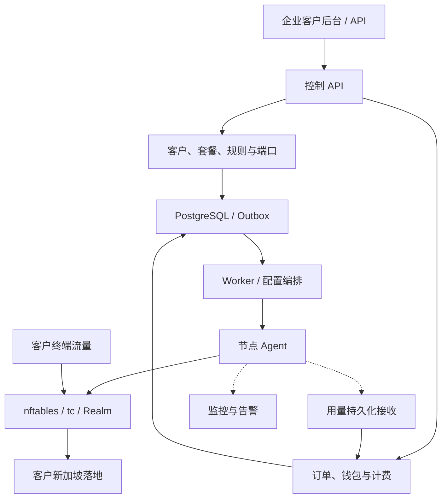

# 系统架构与技术约束

## 节点安装接入（v18）

控制台 HTTPS 提供引导脚本、固定发布元数据及一次性 CSR 注册端点；此端点不依赖尚未取得的客户端证书，也不授予浏览器/企业权限。管理员使用原有会话、同源保护和平台权限生成/撤销 15 分钟随机凭证，数据库仅保存摘要。

兑换在节点事务锁下绑定 CSR 摘要、签发证书、精确证书指纹、版本快照与审计；同 CSR 可以在有效窗口恢复同一结果，不同 CSR 不可重放。手工证书轮换/撤销也撤销旧 bootstrap 恢复权限，不清理 applying 屏障。证书有效期 30 天，尚无自动续签。

安装器使用控制台固定 SHA256 校验 GitHub 指定 tag 的 amd64/arm64 普通文件归档；无自动升级、无 latest 跟随。私钥生成并保留在节点，注册后 systemd 启动非特权 validation 服务。只读环境报告通过现有 mTLS 精确身份通道保存，轮换证书清理旧报告；检查未知不等于可转发。控制台 UI 区分联系、校验和应用结果。发布、真实 systemd/VPS/网络及 PKI 运营验收仍需单独完成。

## 控制面与数据面

用户流量不经过控制 API。控制 API 离线时节点保留最近有效配置，用量本地持久缓冲；额度到期/租约耗尽按明确策略处置。

## 技术分工

| 部件 | 目标方案 |
|---|---|
| 前端 | React/Next.js |
| API、Worker | Go 模块化单体 |
| 业务与账务 | PostgreSQL，事务、唯一约束、版本与不可变账本 |
| 缓存/任务 | Redis；任务由数据库状态兜底 |
| Agent | Go，mTLS、受限权限、配置对账 |
| 数据路径 | nftables DNAT/SNAT，tc 带宽整形 |
| 可选后端 | Realm 用户态代理，独立 Adapter 和计量验证 |
| 监控 | Prometheus/Grafana、Loki、外部探针 |
| 组网扩展 | 企业 WireGuard、网络隔离、路由与 ACL |

当前为 Go HTTP + PostgreSQL + 静态页面。Node.js 只负责本地脚本。事务 Outbox、mTLS、成员权限、规则套餐、账务和默认关闭的支付连接器已实现。Linux 显式应用 Agent 已组合 nftables/tc、WAL、内核逐规则额度/到期保护和 applied ACK；默认模式仍仅校验。React/Next.js、Redis 和企业组网尚未接入，不影响当前 PostgreSQL 事实来源。真实生产平台仍须环境与商业验收。

### 当前控制平台实现

- `cmd/reladock`：连接数据库并执行事务/advisory lock 迁移，连接失败拒绝启动；默认绑定回环，生产模式要求明确 HTTPS origin 与 TLS 证书，公网明文监听被拒绝。
- `internal/platform`：企业、成员、会话、规则、端口资源、幂等请求与审计。注册与规则操作使用事务；密码采用随机盐的 PBKDF2-SHA256（600000 次），会话使用 256 位随机令牌，仅持久化 SHA256 摘要，24 小时有效，退出立即撤销。
- `internal/web`：认证、租户写授权、同源/Host 检查、定制请求头、严格 JSON、8 KiB 业务正文限制和 HTTP 超时。开发模式进程内限流，生产模式 PostgreSQL 共享限流；Cookie 为 HttpOnly、SameSite=Strict，HTTPS 下启用 Secure/HSTS。独立支付 webhook 验签原始报文，上限 256 KiB，具有独立预算。
- 端口按 `(node_id, listen_address, protocol, listen_port)` 数据库主键唯一；节点级事务锁分配 20000–60000 范围最小可用端口。TCP/UDP 可共用相同数字端口；both 同时预留，两者与规则、幂等记录、审计一起提交或回滚。
- 创建规则必须提交企业内唯一的 `Idempotency-Key`（8–128 位字母数字及 `._:-`）；相同规范化请求重放返回原规则，不同请求返回冲突。幂等记录暂不自动过期。
- 暂停保留端口；删除软删除规则并入队缺席快照。未曾进入 applying 的端口可以释放；曾下发端口永久保留隔离，移除 ACK 之后仍需独立 conntrack 安全回收，当前不自动复用。重复暂停/删除不增加版本或审计。
- 规则期望版本从 1 开始；仅 applied 回报推进对应快照的生效版本与 applied_status，校验不推进。节点 generation 与规则版本分开。applied 不代表端到端健康，页面不得显示运行中；无虚构充值、流量或余额。
- 审计记录账户注册/登录/退出与规则创建/暂停/删除，查询仅返回本企业最近 50 条；尚未提供独立防篡改审计存储。
- 注册只创建 owner。邀请仅生成 admin/viewer；角色变化撤销旧会话和 Key。Key 仅保存摘要，按 read/write 范围与当前数据库角色复核，不具备平台权限。每直接连接 IP 每分钟 120 次 API，认证预算 10 次；不信任代理转发头。
- 数据库使用项目独立容器与数据卷，仅映射 `127.0.0.1:55434`。集成测试建立随机 schema 并清理自身数据，不清空业务表。旧 JSON 不自动导入，因为缺少可信租户归属。

### 节点配置交付（v2）

平台后台与运维 CLI 管理全局节点、维护标志、精确证书摘要与人工重试；普通企业账号只读节点元数据。节点维护只拒绝新规则预留，不隐含暂停既有规则。`node_operator_events` 保留历史运维记录，v3 新操作写入 `platform_audit_logs`；企业审计仍只返回本企业。

`config_outbox` 保存不可变 payload、SHA256 checksum、generation、状态、尝试次数与租约。创建/暂停/恢复/删除规则时，先获取节点事务锁，再更新规则/端口、生成完整快照、写审计，全部原子提交；创建还先获取企业幂等锁。快照包括节点全部未删除规则及企业标识，暂停规则明确标识，删除通过完整期望集合中缺失表达。当前 payload 上限 2 MiB，历史快照暂不清理。

Agent 领取最新 generation，领取租约 60 秒，最多 5 次。应用前以同一 token/checksum 调用 begin；节点锁与唯一 applying 索引串行化。applying 不因租约过期自动清除，防止旧执行者尚未停止时新任务进入。规则变更可以排队，但 Claim 不绕过应用屏障。陈旧 applied 仅记录其实际版本，不能确认较新删除。失败只能在独立本地 Stable 核对后终结；未知结果保留 Agent journal 和平台屏障。丢失状态或轮换后无法恢复凭据须人工核对，不能通过超时或随意 SQL 清屏障。

可选 Agent HTTPS 服务单独监听 `127.0.0.1:3002`，要求 TLS 1.3 与客户端 CA 验证。证书 URI 必须是 `spiffe://reladock/nodes/<id>`，每次请求验证登记摘要，领取/回报事务在节点锁下再次检查摘要，防止轮换期间旧身份继续操作。浏览器 Cookie 不授予 Agent 权限。轮换废弃旧租约、生成新快照，重新认证旧证书失败。开发 CA/私钥不自动分发或启用，未设置 `AGENT_TLS_DIR` 时不监听该端口。

默认 Go Agent 校验快照并报告 validated/failed，不执行网络。显式应用模式在同一跨进程数据面锁中：持久候选 → 冻结平台 relay 链 → 最终 counter 落盘 → 按固定周期基线＋跨 epoch 本地实际用量重建额度 → 受控 tc → nft 原子替换/回读 → 新物理 incarnation/WAL → 最后有效状态 → applied ACK。回滚也先采样并创建独立 incarnation；不能用 generation 代替物理计数代次。已确认报告才从 WAL 清理，ACK 不清除周期累计。存储满/不确定结果停止转发或保留屏障，不静默丢用量。节点 last_seen_at 仅为控制联系时间。

tc 采用每规则双向合计上限，双方必须经过同一个显式专用 egress；packet mark 把 TCP/UDP 及上下行映射到同一 HTB class，真实路由不匹配则该业务包 drop。未配置保障带宽。读取 class 时优先使用 JSON，并严格兼容 iproute2 5.15 可能返回的 HTB 文本；不完整、未知或溢出的输出拒绝应用。nft quota 对每规则上下行共享，替换前用持久已用量减去剩余额度；到期用内核 timed set，即使 Agent 停止也不无限转发。冻结规则在 owned table 内按真实 drop 表达式回读确认并幂等插入，不能仅凭 comment 信任；历史重复的有效冻结由后续成功原子替换清理。30s 应用/恢复预算配合 35s 保守到期余量，可能提前最多约 35s 停止，不能销售秒级短周期。运行时拒绝 flowtable 及 GRO/GSO/TSO/LRO 绕过条件，前置网络设置由节点运维明确完成，不由 installer 修改。参阅 DATAPLANE、SHAPING 和 METERING 文档。

### 全平台权限与管理（v3）

`members.is_platform_admin` 独立于企业角色，公开注册默认 false；只通过本机 CLI 指定已有邮箱授予/撤销。变更与清除成员全部会话、平台审计同事务。登录/会话查询每次读取当前平台标志和企业状态，不依赖前端标志或旧 Cookie 内的角色。

管理 API 位于 `/api/admin/*`，使用现有同源、Host、请求头、严格 JSON、会话和限流保护。页面 `/admin` 只是静态壳，不包含敏感数据；所有管理查询与写操作在数据库重新核验平台权限。平台授权变更、管理事务和退出登录统一先获取授权事务锁，避免权限撤销竞争及 session→账户外键锁顺序反转。管理节点再获取节点锁、规则再获取行锁；普通租户写入在事务内核验企业 active 和成员权限。

节点新增/编辑/维护/证书轮换与撤销/配置重试和平台审计原子提交；运维 CLI 与网页共用节点修改逻辑。`nodes.revision` 用于旧页面冲突保护，规则变更使用 desired_version，企业登录状态使用 tenants.revision。节点有未删除规则时不能变更绑定地址，声明速率不能低于已保存规则速率；新规则也不能超过声明速率。元数据并不代表实际已应用或健康。

平台可分页查看企业和全局规则，并操作其他企业的规则配置；平台规则操作只记录平台管理员身份，不伪装成租户成员，不改变普通租户查询范围。企业登录停用会清除其所有会话、拒绝登录与后续写入，但不自动暂停规则或保证停止现有流量。含平台管理员的企业不能停用。

`platform_audit_logs` 保存操作人、动作、资源和非敏感说明，不保存密码、会话、证书正文或私钥；审计失败回滚业务操作。平台审计最近 100 条，交付详情最近 30 条；交付接口不返回完整快照和租约令牌。尚未提供防篡改外部审计归档或生产容量验收。

## 数据模型

Tenant、Member、Node、NodePool、EndpointAllocation、RelayRule、Path、DesiredConfig、AppliedConfig、UsageEvent、UsageBucket、Plan、PriceVersion、Order、Payment、LedgerEntry、Invoice、Probe、Incident、AuditLog。组网预留 Site、Gateway、Network、Route、AccessPolicy、Link。

## 关键设计

端口按节点/监听地址/传输/端口唯一分配。配置使用版本、幂等任务和回报确认；状态区分 pending、active、failed、paused 和 deleting。并发更新使用乐观锁。Agent 只修改本平台规则与配置。

DNAT 转发一般需要 SNAT 保证回程，客户源站看到中转 IP；需要真实源 IP 时单独设计回程或应用兼容，不能默认承诺。

计量不读 NAT 首包 counter 计算全流量。内核转发和 Realm 本地代理使用不同计数路径；标识客户与规则并统计实际业务包，避免 offload 绕过。用量 event 包含 node、epoch、sequence、rule、累计上下行和时间。节点 WAL、接收 ACK、去重、计数清零处理与账本事务共同保证可对账。

钱包用 USD 整数最小单位/定点数，价格与套餐版本化。支付回调验签、金额币种检查、幂等、退款冲正和到账对账。计费边界固定，多跳对客户只计一次；上游成本单独统计。

普通 UDP 无通用连接握手，健康需要协议响应或合作探针，未知要显示未知。主备通常只恢复新连接/重连；DNS 缓存和已有 NAT/代理状态限制切换，不能承诺无感迁移。

### 后续业务与部署增量（v4–v12）

流量与带宽按用户最新指令逐规则独立配置，企业钱包只共享货币余额，不共享字节额度。`billing_usage_reports` 与 epoch 保存累计计数、sequence 和去重事实，付费报告必须绑定 `subscriptionId`，周期归属不依赖接收时间。`subscription_usage` 汇总指定周期的实际报告；重复事件不再次扣减，迟到旧周期流量不会扣新周期额度。旧版本中无法归属的付费用量必须先对账，v10 拒绝静默清零或猜测归属。

钱包采用 USD 整数美分、行锁及不可变账本；套餐价格版本不可变。购买绑定企业自己的规则、价格版本与幂等键，扣费/周期/规则带宽/Outbox/审计同事务。配额耗尽与到期只请求暂停配置，实际停止仍取决于 Agent。无预置套餐；无有效套餐的规则可以保留端口草稿，但快照中的状态保持 paused。v11 重建所有节点的最新快照以收紧旧版本行为。

Stripe 是可选连接器，不是已选定或启用的生产渠道。全部配置缺失时禁用，部分配置拒绝启动。Checkout 先持久化本地幂等订单；只有验签回调、已支付状态、金额/币种/订单元数据和会话绑定全部匹配才创建到账账本。重复事件不重复到账；异常/无法自动冲正的退款及争议事件持久记录待人工复核，并冻结后续钱包支出，不能伪造处理成功或自动解除冻结。参见 PAYMENTS.md。

每 30 秒进行到期与控制通道告警对账。节点/配置事件去重，后台与企业工单隔离；联系健康和转发健康分别表达。HTTPS 运行配置、Linux 发布包与组件安装模板参见 DEPLOYMENT.md；独立 Adapter 的权限、回滚和真实 Linux 测试参见 DATAPLANE.md。

监控数据不充当财务账本。不采集业务载荷，不解密客户 TLS。企业组网按租户隔离网络、路由与权限，处理重复网段、MTU、DNS 和撤权。
